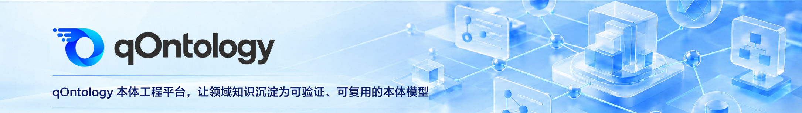

 
 
 
 
 
 
 

  <a href="README.md">📖 Simplified Chinese</a> | 📖 English

## 🌈 Platform Overview

qOntology is an open-source ontology engineering platform for enterprise knowledge engineering. Grounded in ontology and aligned with Semantic Web standards such as OWL, RDF, and SHACL, it focuses on enterprise ontology governance and semantic governance. Through unified modeling and semantic asset management, qOntology connects knowledge graphs, enterprise operational ontologies, and ontology-driven AI to build a unified, open, and evolvable enterprise semantic infrastructure.

✨✨✨ **Open-Source Edition Demo** ✨✨✨ <a href="https://qontology.qiantong.tech" target="_blank">https://qontology.qiantong.tech</a>

Username: `qOntology`  
Password: `qOntology123`

> If you find qOntology helpful, please give us a **Star ⭐️**. Your support motivates us to keep improving! 🚀

## 🎯 What Can You Build with qOntology?

You can use qOntology to plan and build:

- A unified terminology and concept system for domain-specific projects
- Ontology models consisting of object types, properties, relationships, and constraints
- Model coverage checks based on modeling goals expressed as competency questions (CQs)
- Lightweight mappings from business data to object types and properties, with sample previews
- Versioned, exchangeable ontology assets
- Knowledge extraction workflows and knowledge graphs based on published ontologies

## ✨ Why Choose qOntology?

| Key Capability | Description |
|----------------|-------------|
| 🎯 Goal-Driven Modeling | Capture modeling goals as business questions (CQs) and check how well the ontology covers them. |
| 📚 Unified Terminology and Semantics | Manage terms, aliases, data types, and enumerations to establish a consistent domain language. |
| 🔗 Object Relationship Modeling | Maintain object types, properties, relationships, and basic SHACL constraints. |
| ✅ Quality and Version Management | Validate model structure and basic constraints while preserving versions and change history. |
| 🔄 Standard Format Exchange | The open-source edition is planned to support Turtle RDF/OWL and SHACL Turtle exports. |
| 🧱 Modular Architecture | System administration, foundational management, and ontology modeling are organized into separate modules for easier capability expansion. |
| ☕ Java-Friendly Technology Stack | Built on JDK 17 and Spring Boot 3, the backend supports private deployment and further customization. |

## 🍱 Typical Use Cases

| Use Case | Description |
|----------|-------------|
| **Domain Ontology Design** | Define object types, properties, relationships, and constraints, starting from modeling goals and terminology. |
| **Business Semantic Governance** | Centrally manage project information, data types, enumerations, and business terminology. |
| **Data Mapping Validation** | Map database table fields to the ontology and preview a small set of sample object instances. |
| **Model Quality and Release Management** | Validate ontology structure and basic constraints, compare versions, and publish releases. |
| **Knowledge Graph Development** | Visualize objects and their relationships based on ontologies and extraction results. |

## 🚀 Core Strengths

- **Comprehensive Modeling Elements**: Describe domain semantics through modeling goals, terms, object types, properties, relationships, and constraints.
- **Clearly Defined Validation Scope**: The open-source edition focuses on source completeness, duplicate identifiers, cyclic inheritance, dangling relationships, type checks, and basic constraint checks.
- **Traceable Model Evolution**: Compare changes to terms and ontology elements across versions, publish releases, and preserve change history.
- **Lightweight Data Connectivity**: Use field mappings and previews of a small set of object instances to validate the correspondence between models and data.
- **Open Exchange Formats**: The open-source edition is planned to support Turtle RDF/OWL and SHACL Turtle exports.

## ✨ Core Features

| Feature Module | Description |
|----------------|-------------|
| System Administration | Manage users, roles, menus, departments, positions, dictionaries, parameters, notices, announcements, and logs. |
| Project Management | Maintain basic ontology project information, including domain, scope, and namespace. |
| Data Source and File Management | Register data sources; categorize, upload, and manage Word documents, PDFs with extractable text, and TXT files; store plain-text extraction results for each file. |
| Data Types and Enumerations | Maintain platform-level data types and enumerations, reference them in projects, or define project-specific entries. |
| Modeling Goals (CQs) | Record business questions, priorities, and acceptance criteria in natural language; link them to ontology elements and check coverage. |
| Terminology Management | Manage definitions, aliases, sources, and mappings between terms and ontology elements. |
| Object Types and Properties | Define object types and inheritance relationships; configure property data types, cardinality, default values, units, and enumerations. |
| Object Relationships and Constraints | Define relationships between object types and configure basic SHACL constraints. |
| Ontology Quality Validation | The open-source edition is planned to provide checks for source completeness, duplicate identifiers, cyclic inheritance, dangling relationships, types, and basic constraints. |
| AI-Assisted Modeling | The open-source edition is planned to generate candidate ontologies from plain-text files for human review and confirmation. |
| Version Management | Compare changes to terms and ontology elements, assess their impact on modeling goals, and publish versions after quality checks pass. |
| Data Mapping Lite and Instance Preview | Create lightweight field mappings to object types and properties, and preview a small set of sample object instances. |
| Import and Export | Manage model exchange tasks; the open-source edition is planned to export Turtle RDF/OWL and SHACL Turtle. |
| Ontology Applications | Perform unstructured and structured data extraction based on published ontologies to build knowledge graphs. |

## 🛠️ Technology Stack

qOntology uses a decoupled frontend and backend architecture. The backend is built on JDK 17 and Spring Boot 3.5.8, while the frontend uses Vue 3 and Vite 5. The table below reflects the current project configuration. Some components are optional modules and do not need to be enabled in every deployment.

<table>
  <tr>
    <th>Category</th><th>Technology / Framework</th><th>Description</th>
  </tr>
  <tr>
    <td rowspan="8">Backend</td><td>JDK 17</td><td>Backend runtime environment</td>
  </tr>
  <tr>
    <td>Spring Boot 3.5.8</td><td>Core backend framework</td>
  </tr>
  <tr>
    <td>Spring Security</td><td>Authentication and authorization</td>
  </tr>
  <tr>
    <td>MyBatis Components</td><td>Relational database access and mapping</td>
  </tr>
  <tr>
    <td>Spring Framework</td><td>Foundational infrastructure, including dependency injection and aspect-oriented programming</td>
  </tr>
  <tr>
    <td>Quartz</td><td>Scheduled task execution (optional)</td>
  </tr>
  <tr>
    <td>Neo4j Module</td><td>Graph database integration (optional)</td>
  </tr>
  <tr>
    <td>Alibaba Druid</td><td>Database connection pooling for optimized database access performance</td>
  </tr>

  <tr>
    <td rowspan="8">Frontend</td><td>Vue 3</td><td>Progressive frontend framework</td>
  </tr>
  <tr>
    <td>Vite</td><td>Fast build tool</td>
  </tr>
  <tr>
    <td>Element Plus</td><td>UI component library</td>
  </tr>
  <tr>
    <td>Axios</td><td>HTTP client library</td>
  </tr>
  <tr>
    <td>Pinia</td><td>Frontend state management</td>
  </tr>
  <tr>
    <td>Vue Router</td><td>Frontend routing</td>
  </tr>
  <tr>
    <td>Vis Network / AntV</td><td>Graph and relationship network visualization components</td>
  </tr>
  <tr>
    <td>ECharts</td><td>Data visualization library supporting multiple chart types</td>
  </tr>

  <tr>
    <td rowspan="5">Third-Party Dependencies</td><td>MySQL</td><td>Relational database</td>
  </tr>
  <tr>
    <td>Neo4j</td><td>Graph database used when the corresponding modules are enabled</td>
  </tr>
  <tr>
    <td>Redis</td><td>Caching and high-performance data retrieval</td>
  </tr>
  <tr>
    <td>Swagger / OpenAPI</td><td>API documentation generation and testing tools</td>
  </tr>
  <tr>
    <td>Docker (Optional)</td><td>Containerized deployment support</td>
  </tr>
</table>

## 🏗️ Deployment Requirements

Before deploying qOntology, prepare the following environments according to the modules you plan to enable:

<table>
  <tr>
    <th>Environment</th><th>Component</th><th>Recommended Version</th><th>Notes</th>
  </tr>
  <tr>
    <td rowspan="6">Backend</td><td>JDK</td><td>17</td><td>Must match the Java version specified in the root POM</td>
  </tr>
  <tr>
    <td>Maven</td><td>3.8+</td><td>Project build and dependency management</td>
  </tr>
  <tr>
    <td>MySQL</td><td>A version compatible with the current driver and scripts</td><td>Relational database; review the initialization scripts first</td>
  </tr>
  <tr>
    <td>Neo4j</td><td>A version compatible with the module configuration</td><td>Required only when using graph database capabilities</td>
  </tr>
  <tr>
    <td>Redis</td><td>A version compatible with the current configuration</td><td>Caching service</td>
  </tr>
  <tr>
    <td>Operating System</td><td>Windows / Linux / macOS</td><td>Runs on common operating systems</td>
  </tr>

  <tr>
    <td rowspan="3">Frontend</td><td>Node.js</td><td>18+</td><td>Development and build environment for Vite 5</td>
  </tr>
  <tr>
    <td>npm / pnpm / yarn</td><td>Any one of these</td><td>Package manager</td>
  </tr>
  <tr>
    <td>Vue 3 / Vite 5</td><td>As specified in package.json</td><td>Frontend development and build tools</td>
  </tr>
</table>

## 🚀 Quick Start

👉 Click the link below for the complete installation and deployment guide:

[🧭 View the Quick Start Guide](QUICKSTART.md)

## 🚨 Commercial Licensing

qOntology is planned to offer an **Open-Source Edition** and a **Professional Edition**. The Open-Source Edition focuses on domain modeling, basic quality validation, lightweight data mapping, sample previews, and standard format exports. The Professional Edition expands these capabilities with visual modeling, runtime objects, actions, functions, and ontology-driven business capabilities.

👉 For **custom branding licenses** or **Professional Edition inquiries**, [<u>click here</u>](https://qm.qq.com/q/KPe3zhgdqk) to add Wu Datong on QQ, or **scan the QR code below**.

## 👥 QQ Community

> Join the **official qOntology QQ community** to exchange ideas, learn, and grow with fellow developers. Follow the steps below to join:

First, add **Wu Datong on QQ** ([<u>click here to add</u>](https://qm.qq.com/q/KPe3zhgdqk) or **scan the QR code below**). Then send a **screenshot showing that you have starred the project on [<u>Gitee</u>](https://gitee.com/qiantongtech/qOntology) or [<u>GitHub</u>](https://github.com/qiantongtech/qOntology)** to join the group.

## 🖼️ Screenshots

<table>
    <tr>
        <td>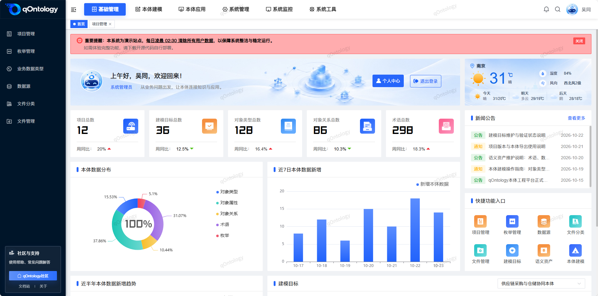</td>
        <td>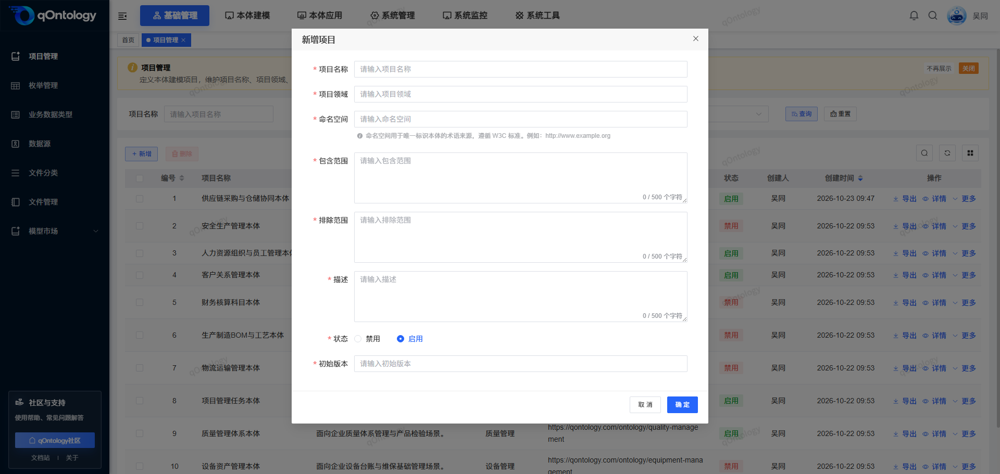</td>
    </tr>
    <tr>
        <td>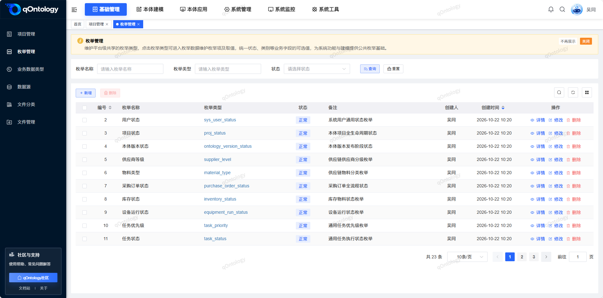</td>
        <td>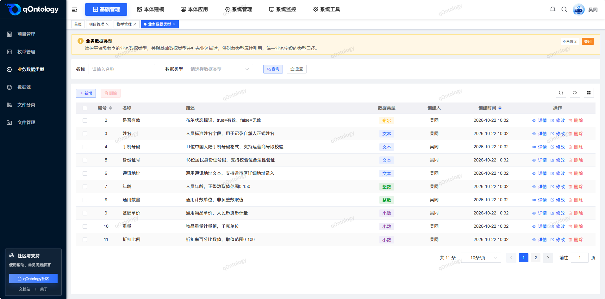</td>
    </tr>
    <tr>
        <td>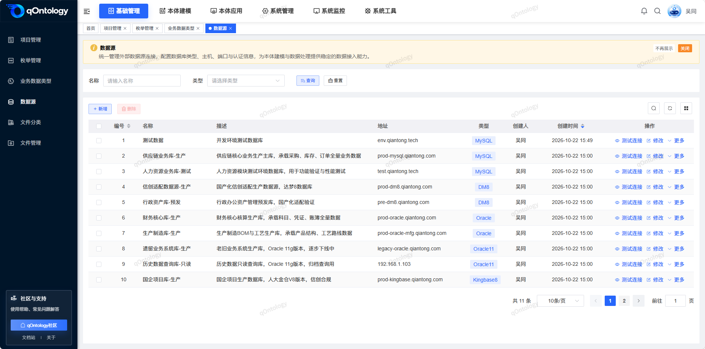</td>
        <td>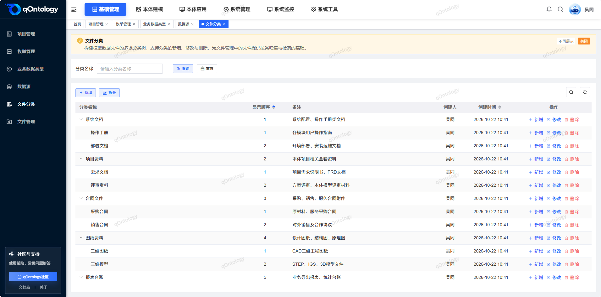</td>
    </tr>
    <tr>
        <td>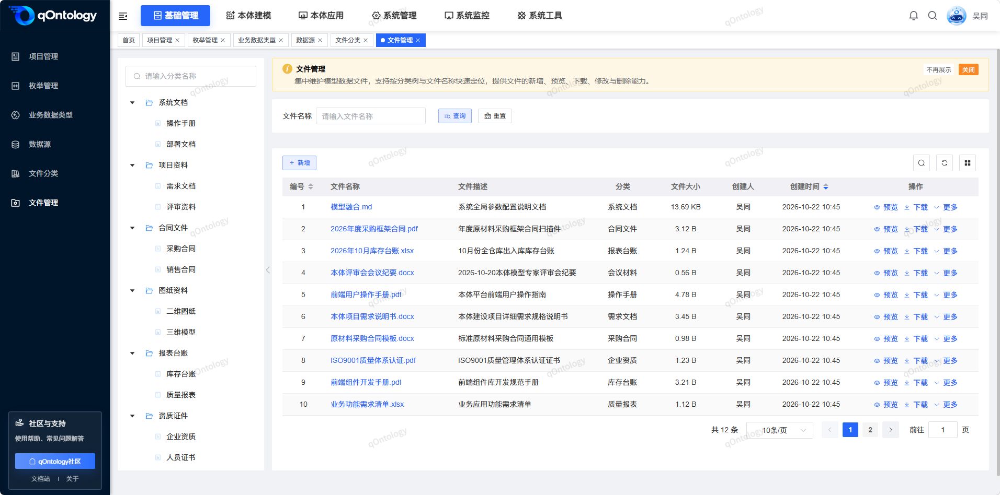</td>
        <td>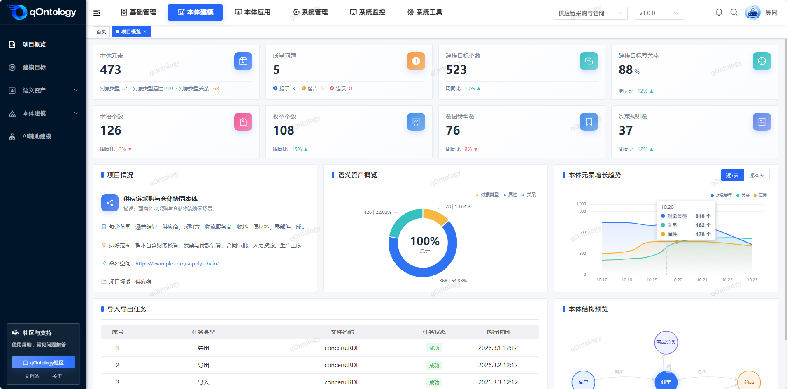</td>
    </tr>
    <tr>
        <td>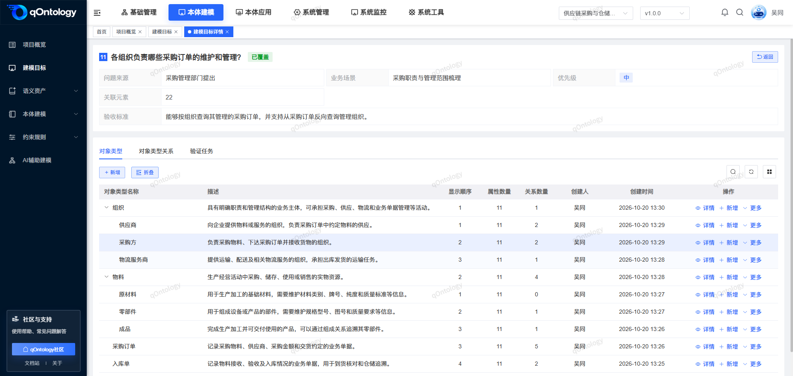</td>
        <td>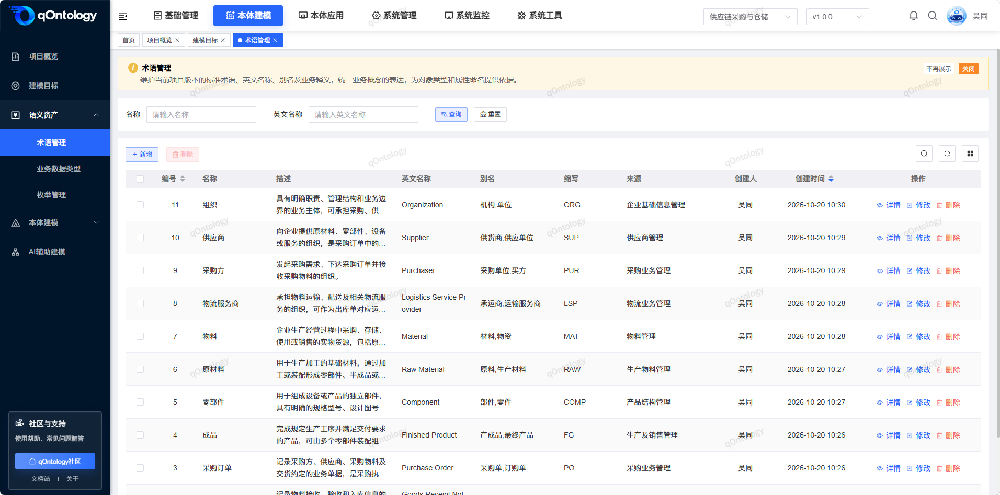</td>
    </tr>
    <tr>
        <td>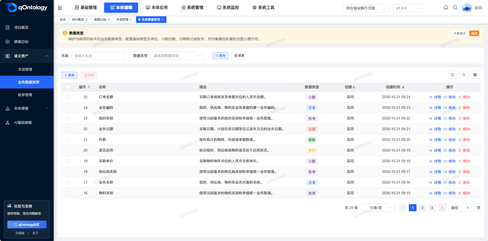</td>
        <td>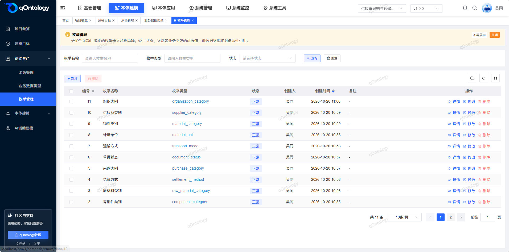</td>
    </tr>
    <tr>
        <td>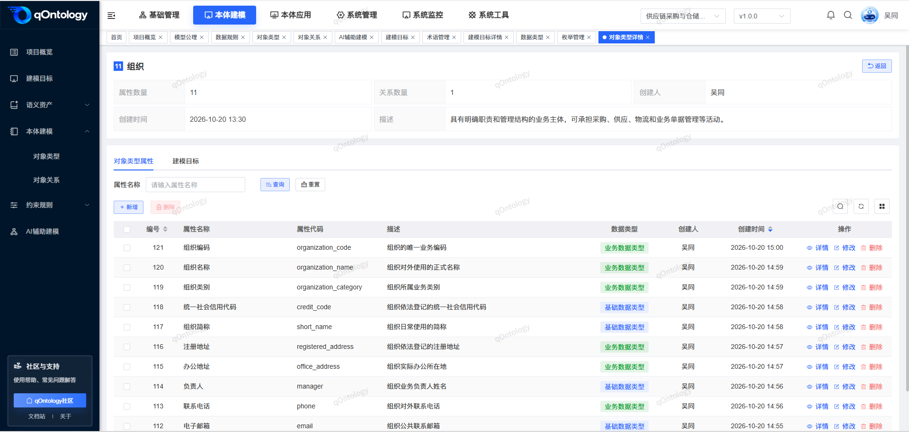</td>
        <td>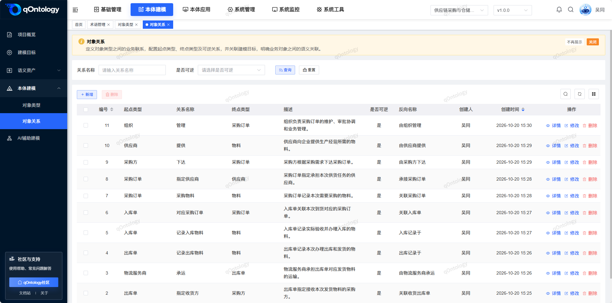</td>
    </tr>
    <tr>
        <td>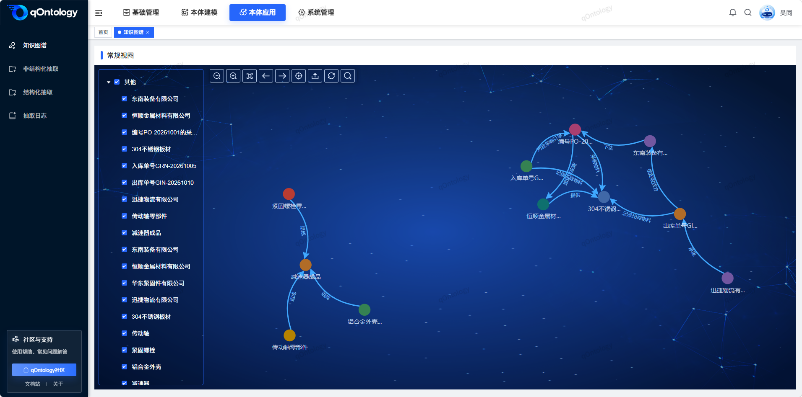</td>
        <td>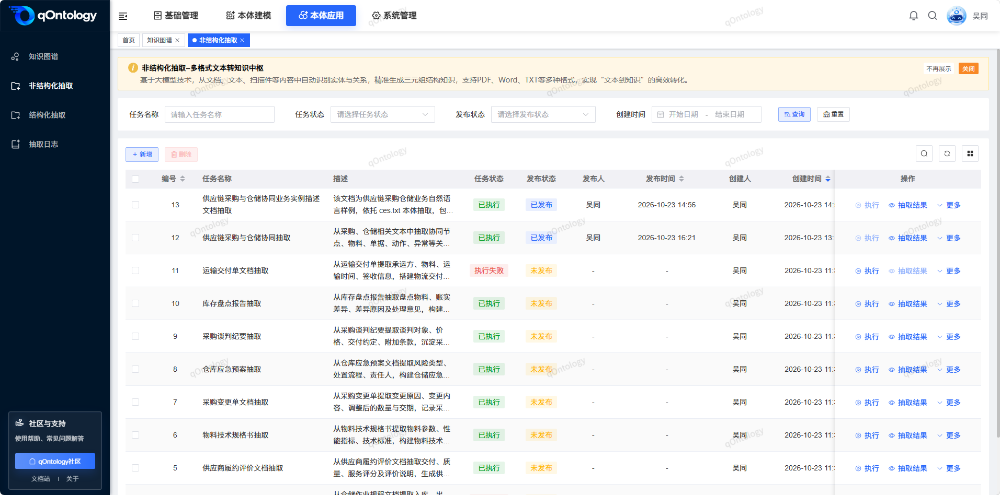</td>
    </tr>
    <tr>
        <td>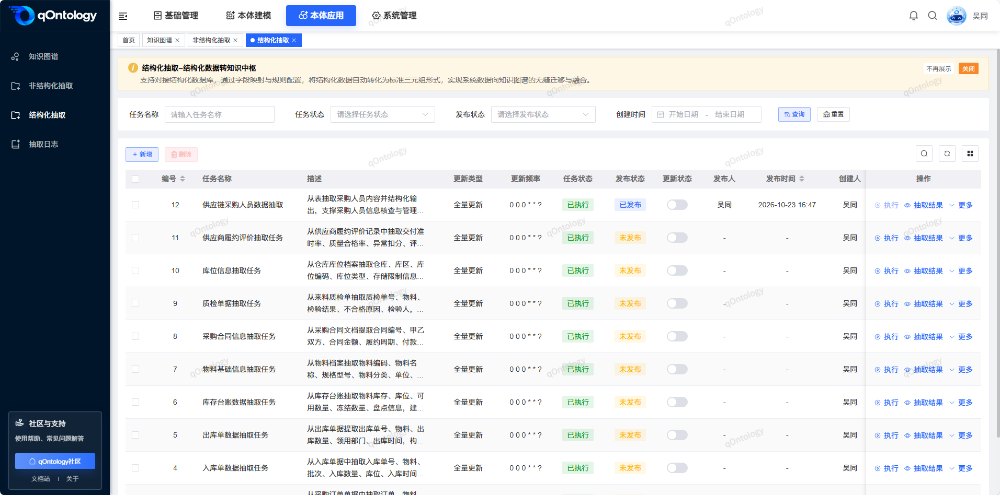</td>
        <td>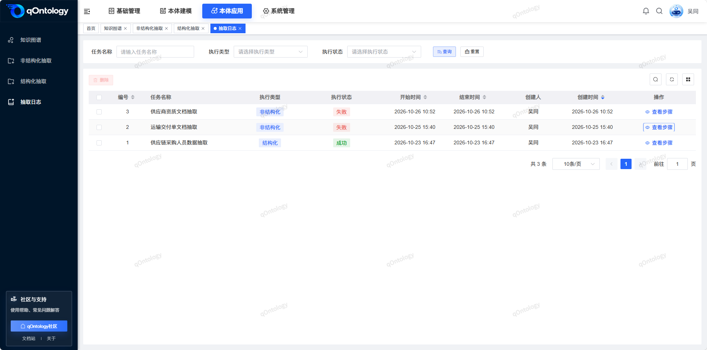</td>
    </tr>
</table>
