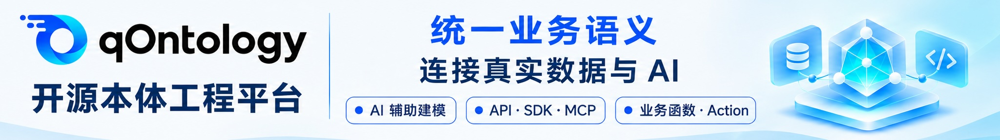

 
 
 
 
 
 
 

  <a href="README.zh-CN.md">📖简体中文</a> | <a href="README.md">📖English</a> | 📖日本語

## プラットフォーム概要

**業務オブジェクトを軸に意味を統一し、データを結び付け、アプリケーションや AI が再利用できる業務機能を提供します。**

qOntology は、企業の知識エンジニアリング向けのオープンソースのオントロジーエンジニアリングプラットフォームです。業務上の概念を統一し、データを関連付けることに重点を置いています。業務のオブジェクト、プロパティ、関係、ルールをデータベース、API、文書内の実データと結び付け、ドメインモデリングからオブジェクトの構築、検索、計算、業務処理の実行までを支援します。

プロジェクトのドメインモデルを定義して複数のデータソースを整理し、オントロジーを活用した質問応答、AI エージェント、業務アプリケーションを開発できます。API、SDK、MCP を通じてモデル、データ、業務ロジックを既存システムに組み込むこともできます。複数のアプリケーションで同じ業務定義、オブジェクト間の関係、呼び出しルールを共有できます。

**[オンラインドキュメント](https://docs.qontology.cn/)** · **[デモ環境](https://demo.qontology.cn)**

> qOntology が役に立ったら、ぜひリポジトリにスター ⭐ を付けてください。

## 業務オブジェクトから始める

qOntology の **オブジェクトタイプ** は業務上の対象の意味と構造を定義し、**オブジェクトインスタンス** は個々の設備、注文、顧客などに対応します。データマッピングと知識抽出で実際の記録をオブジェクトに関連付け、関数や Action で業務処理を呼び出せるようにします。

設備保守を例に、次のように業務を整理できます。

| 設備を軸に整理する内容 | 表現・実装方法 |
| --- | --- |
| **業務定義** | 設備、作業指示、保守担当組織を定義し、設備番号、稼働状態、所属組織、関連する作業指示を記述します。 |
| **実データ** | 設備台帳、作業指示一覧、点検・整備文書の情報を同じ設備に結び付け、プロパティと関係の出所を記録します。 |
| **検索と計算** | 未完了の作業指示がある設備を検索し、カスタム関数で残件数や保守の優先順位を計算します。 |
| **業務操作** | 作業指示 API を Action として登録し、権限に応じてフォローアップのタスクを作成し、処理結果と外部システムからの応答を確認します。 |

同じオブジェクトモデルと業務機能を、業務画面、外部アプリケーション、AI エージェントで利用できます。

## クイックスタート

### オンラインで試す

[qOntology のデモ環境](https://demo.qontology.cn)で、インストールせずに機能を確認できます。

**ユーザー名 `qOntology` ／ パスワード `qOntology123`**

まずプロジェクトのオブジェクトタイプ、プロパティ、関係を確認し、次に抽出結果とナレッジグラフを見ると、業務定義と実データのつながりを把握できます。

### デプロイ方法を選ぶ

- **[Docker Compose でデプロイ](https://docs.qontology.cn/deploy/docker-compose-deployment.html)**。手順に沿ってローカル環境を構成・起動し、動作確認やデプロイを行えます。
- **[ソースコードから起動](https://docs.qontology.cn/deploy/build-from-source.html)**。フロントエンドとバックエンドの開発環境を立ち上げ、カスタマイズや機能拡張を行えます。
- **[手動でデプロイ](https://docs.qontology.cn/deploy/manual-deployment/)**。既存のインフラや個別の要件に合わせて、各サービスをインストールし、管理できます。

動作要件、インストール手順、コンポーネントの設定、よくある質問は、[デプロイガイド](https://docs.qontology.cn/docs/deploy/deploy-open-source.html)を参照してください。

## 製品アーキテクチャ

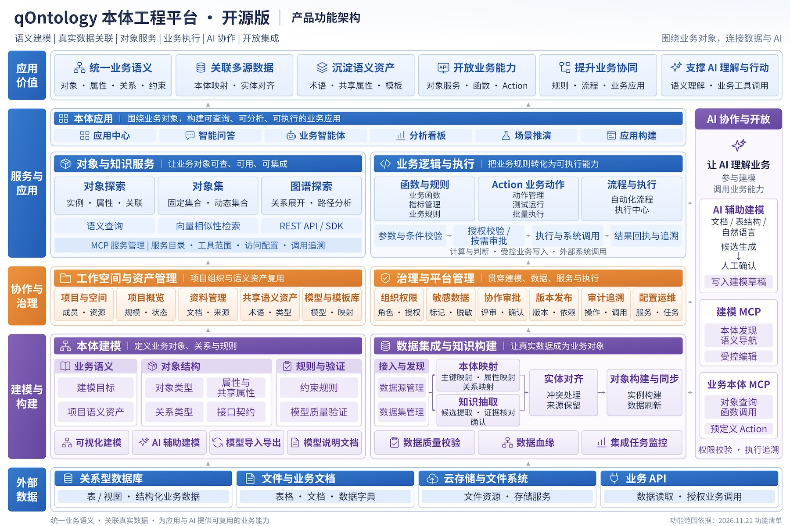

## スクリーンショット

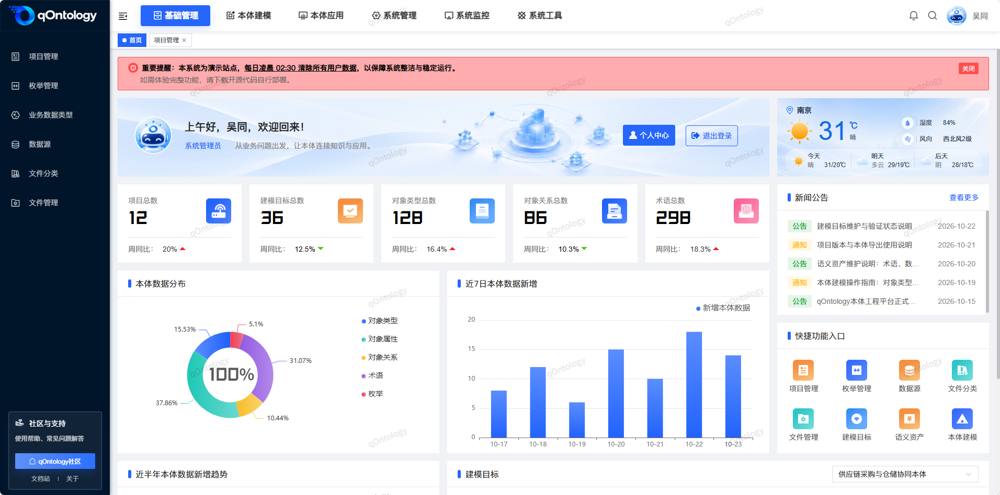

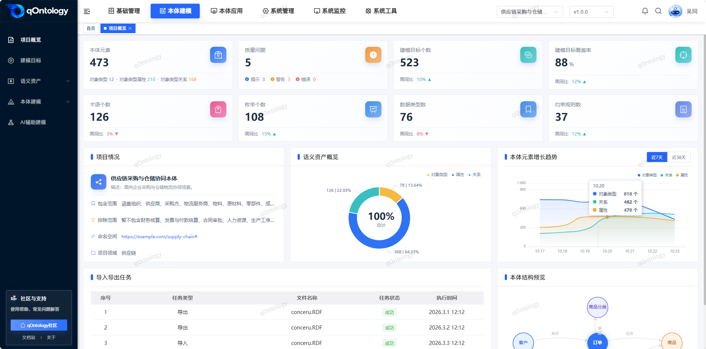

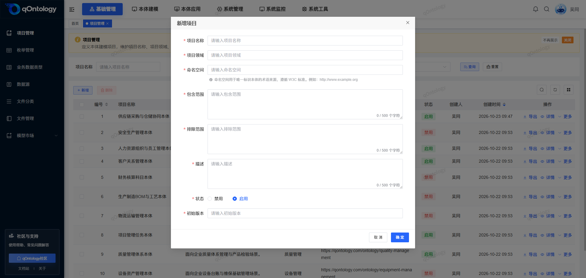

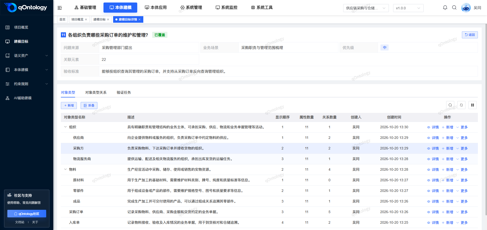

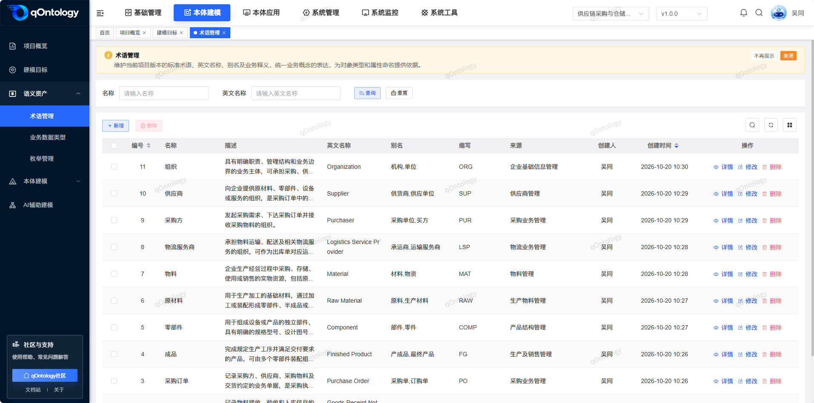

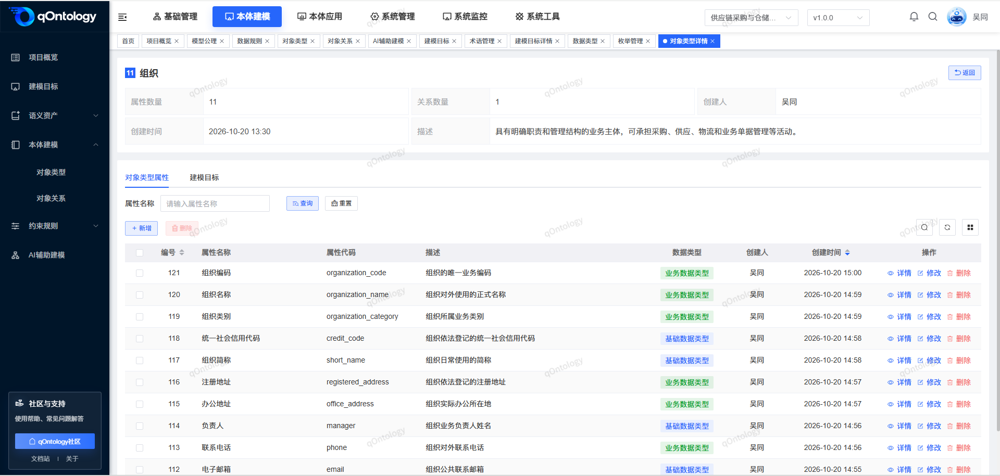

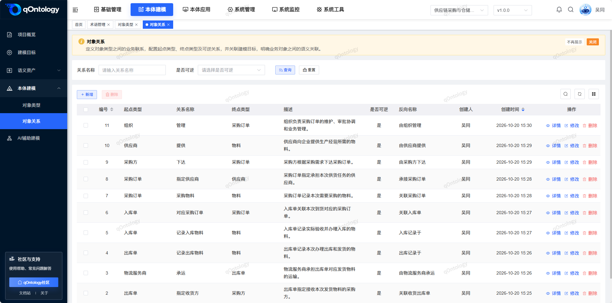

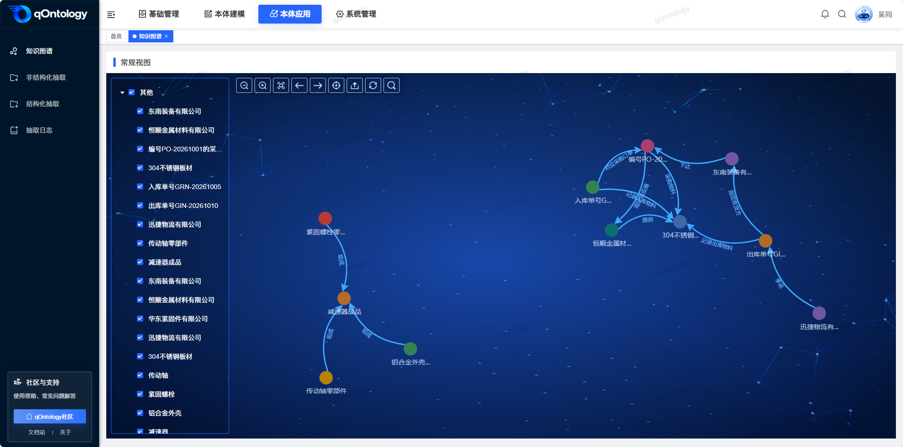

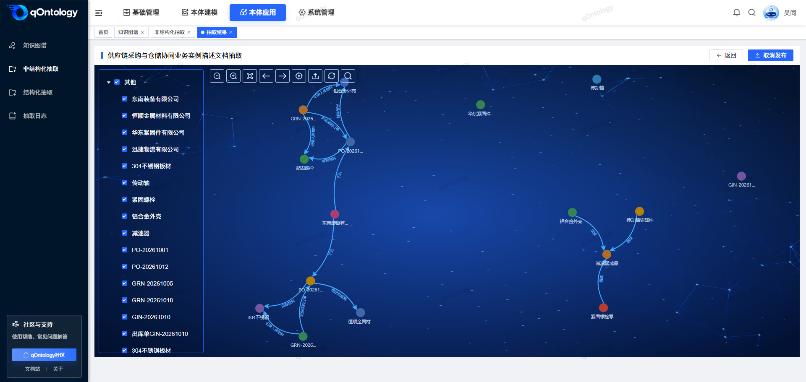

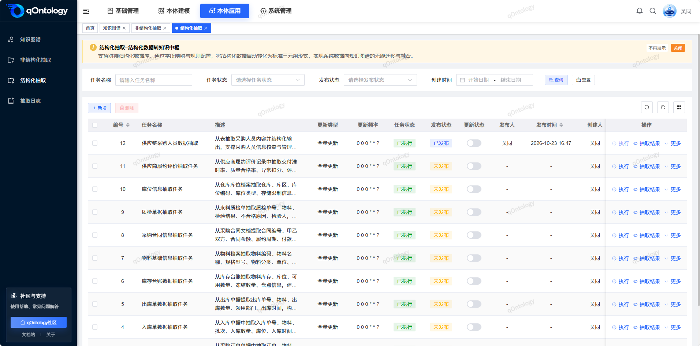

## 主な機能

| 機能領域 | 概要 |
| --- | --- |
| **ワークスペースと資産管理** | プロジェクトとオントロジー空間を整理し、プロジェクト概要や業務資料を管理します。共有用語、プロパティ、型、参照データ、モデルやマッピングのテンプレートをプロジェクト間で参照・再利用できます。 |
| **オントロジーモデリング** | 業務目標に沿ってセマンティック資産を管理し、オブジェクトタイプ、プロパティ、関係、オントロジーインターフェースの契約と制約を定義します。キャンバスや AI の提案を利用してモデルを構築し、構造検証、目標の網羅性確認、インポート・エクスポートを行えます。 |
| **データ統合と知識構築** | データソースを接続し、データセットとオントロジーへのマッピングを管理します。知識抽出、エンティティの照合、競合処理、品質検証を経て業務オブジェクトを構築し、接続方式に応じて更新・同期できます。データリネージやタスクの状態も追跡できます。 |
| **オブジェクト・知識サービス** | オブジェクトの検索、詳細表示、関係の探索、オブジェクトセット、グラフ探索、ベクトル類似検索、セマンティッククエリを利用できます。REST API、SDK、モデリング用 MCP、業務オントロジー用 MCP を通じて機能を提供し、呼び出し範囲、権限、履歴を管理します。 |
| **業務ロジックと実行** | TypeScript や Python の関数で計算を実装し、指標、ルール、Action を設定します。テスト、一括実行、承認、自動化を行い、実行センターでパラメーター、ステータス、結果、外部システムからの応答を確認できます。 |
| **オントロジーアプリケーション** | 質問応答、業務向け AI エージェント、分析ダッシュボード、シナリオシミュレーションを構築します。一覧、詳細、フォーム、グラフの各コンポーネントを組み合わせ、指標や許可済みの Action を設定できます。アプリケーションの管理、操作の設定、プレビュー、公開、アクセス制御に対応します。 |
| **ガバナンスとプラットフォーム管理** | 組織、ロール、リソース権限を管理します。機密データの制御、承認、バージョン公開、依存関係の確認、監査、サービス監視、実行設定を通じて、モデル、データ、業務機能を継続的に管理できます。 |

設定方法、操作手順、API の詳細は、[ドキュメントセンター](https://docs.qontology.cn/)を参照してください。

## 業務上の意味を定義する

業務上の課題から、どのようなオブジェクトがあり、どう関連し、どのルールに従うかを整理し、再利用できるモデルとして定義します。

- **ドメインモデルを構築する**。オブジェクトタイプ、継承関係、プロパティ、オブジェクト間の関係と制約を定義します。オントロジーインターフェースの契約で、複数のオブジェクトタイプに共通するプロパティと意味を定めます。
- **業務用語の意味を統一する**。用語、別名、共有プロパティ、データ型、列挙型、参照データを管理し、モデリング目標を対応するオントロジー要素に関連付けます。業務上の問いをモデルがどこまでカバーしているかを確認できます。
- **キャンバスと AI でモデルを作る**。キャンバスでオブジェクトと関係を作成・整理できます。文書、テーブルのフィールド、自然言語からモデル案を生成し、レビュー後にドラフトへ反映して、構造と制約を検証します。
- **モデル資産を整理して再利用する**。資料とセマンティック資産をプロジェクト単位で管理し、モデルやマッピングのテンプレートを参照できます。オントロジー定義はインポート・エクスポートできます。

## 実データを関連付ける

業務モデルを実際の対象に対応させるには、オブジェクトの識別方法、フィールドの意味、関係の出所、複数のソースから値を選ぶルールを定めます。qOntology はこれらの設定に基づいてオブジェクトを構築します。

- **データに接続してマッピングを定義する**。データベース、ファイル、クラウドストレージ、業務 API に接続し、データセットを検出します。業務上の主キーでオブジェクトを識別し、元のフィールド、外部キー、中間テーブルをプロパティや関係に対応付けます。
- **文書から業務情報を補う**。オントロジーに基づいてオブジェクト、プロパティ、関係の候補を抽出し、根拠となる原文を確認します。検証・承認した結果をオブジェクトの構築に利用します。
- **同一の実体を特定し、値の食い違いを処理する**。業務識別子やプロパティを比較して、複数のソースにある同一の対象を特定します。照合の根拠を確認し、プロパティのソースの優先順位を設定して競合を解消し、担当者による確認を記録します。
- **オブジェクトを構築し、更新する**。マッピングと抽出結果からオブジェクトインスタンスを生成します。接続方式に応じて定期更新、差分更新、オンデマンド読み取りを設定し、更新日時や構築バッチを確認できます。
- **品質を検証し、出所をたどる**。必須項目、一意性、型、関係の整合性を検証します。オブジェクトのプロパティから元のフィールドや文書の該当箇所までさかのぼり、データリネージを使ってマッピングや上流データの問題を特定できます。

## アプリケーションや AI と連携する

アプリケーションは、オブジェクトサービスで情報を取得し、関数やルールで計算・判定を行い、Action を通じて業務データを更新したり、外部システムを呼び出したりできます。

### オブジェクトを検索し、業務計算を再利用する

オブジェクトの検索結果や詳細画面から業務情報を取得し、関係をたどって関連情報を確認できます。検索結果や絞り込み条件をオブジェクトセットとして保存し、分析や一括処理に再利用できます。グラフ探索、セマンティッククエリ、ベクトル類似検索では、関連するオブジェクトや出所となる資料を探せます。

**TypeScript や Python の業務関数**でプロパティの読み取り、関係の探索、複数の計算の組み合わせを実装し、入出力と依存関係を宣言できます。指標やルールを組み合わせ、計算基準や判定ロジックをダッシュボード、業務画面、AI エージェントに提供できます。

### Action で業務操作を実行する

業務関数、HTTP API、MCP ツールを **Action（業務操作）** に関連付け、パラメーター、事前条件、実行権限を設定します。必要に応じて確認や承認を追加できます。Action でオブジェクトや関係を更新したり、連携先の業務システムを呼び出したりできます。

Action のテスト、一括実行、処理の自動化に対応しています。実行センターで入力パラメーター、実行ステータス、結果と応答を確認でき、失敗の原因を特定して対処できます。検索、計算、実行にそれぞれ専用のインターフェースがあり、業務操作の履歴を追跡できます。

### アプリケーションや AI の接続方法

| 接続方法 | 用途 |
| --- | --- |
| **REST API / SDK** | 既存アプリケーションからオブジェクトを検索し、関係をたどり、定義済みの Action を呼び出します。REST API から業務関数を呼び出し、オントロジーのデータとロジックを再利用できます。 |
| **モデリング用 MCP** | AI 開発ツールにオントロジーの検索、意味関係の探索、権限に基づく編集を提供し、モデル定義の理解と管理を支援します。 |
| **業務オントロジー用 MCP** | AI エージェントに実データに基づくオブジェクト検索、関数、定義済みの Action を提供します。許可された範囲で業務データや実行機能を利用できます。 |

プラットフォーム上で直接、質問応答、AI エージェント、分析ダッシュボード、シナリオシミュレーションを構築することもできます。オブジェクトの一覧や詳細、フォーム、グラフを組み合わせ、指標や Action を設定して、業務向けの操作画面を公開できます。

サービスの設定、呼び出し方、操作手順は、[ドキュメントセンター](https://docs.qontology.cn/)を参照してください。

## モデル、データ、実行を継続的に管理する

モデル、データマッピング、アプリケーションは運用中に変化します。qOntology ではセマンティック資産の管理、公開、利用を関連付けることで、チームが依存関係を継続的に管理できます。

- **バージョンと変更の影響**。モデル、マッピング、関数、Action のバージョンを管理します。変更内容を比較し、依存関係と互換性を確認して、影響を受ける可能性のあるサービスやアプリケーションを特定します。
- **レビューと公開**。品質チェック、公開時の承認、変更履歴を通じて、共有する業務定義や呼び出し契約の変更を追跡できます。
- **権限の分離**。プロジェクトとロールごとに、モデル編集、オブジェクトや機密フィールドへのアクセス、業務操作の実行に関する権限を設定します。
- **運用と監査**。データ統合タスク、オブジェクト構築、Action の実行履歴を確認できます。サービスの呼び出しや手動変更を追跡し、ログ、ステータス、運用指標を使って問題を調査します。

## 開発と拡張

qOntology はフロントエンドとバックエンドを分離しています。ドメインモデルとデータマッピングから始め、業務関数、Action、API 連携を段階的に追加できます。フロントエンドとバックエンドのコードもカスタマイズできます。

| レイヤー | 主な技術 |
| --- | --- |
| バックエンド | JDK 17、Spring Boot 3、Spring Security、MyBatis 関連コンポーネント |
| フロントエンド | Vue 3、Vite、Element Plus、Pinia、ECharts |
| データストアと基盤サービス | MySQL、Redis、Neo4j。使用する機能とデプロイ構成に応じて準備します。 |

## QQ コミュニティ

公式 QQ グループでは、オントロジーモデリング、データの関連付け、API 連携、導入事例について情報交換できます。利用時の問題を報告したり、最新情報を確認したりすることもできます。

👉 **[QQ グループに参加する](https://docs.qontology.cn/discuss.html)**

## ライセンスと商用サービス

qOntology は [江苏千桐科技有限公司](https://qiantong.tech/)がメンテナンスしており、**Apache License 2.0 とプロジェクトの追加条件**のもとで商用利用できます。利用にあたっては、[LICENSE](LICENSE) に従い、指定されたロゴ、著作権表示、ライセンス表記、クレジットを保持してください。

関連する表示の削除や変更、ホワイトラベル化、OEM、別製品としての再パッケージ化には、該当する商用ライセンスを取得してください。ブランドのカスタマイズ、Professional Edition、技術サービスについては、[商用サービスの案内](https://docs.qontology.cn/business/policy.html)を参照してください。
