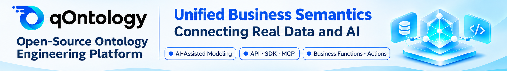
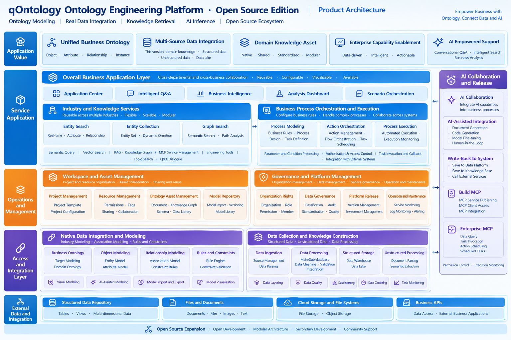
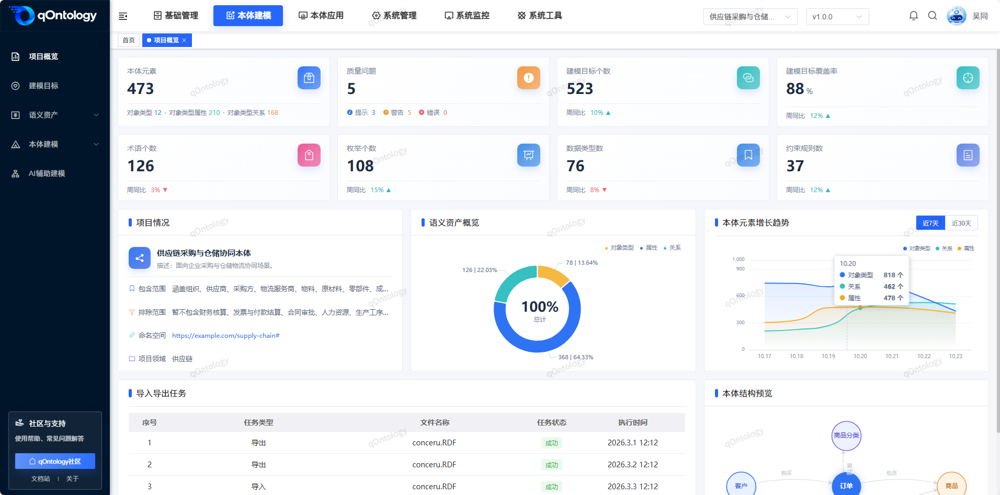
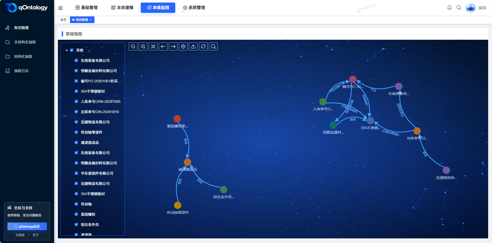

 
 
 
 
 
 
 
 

  <a href="README.zh-CN.md">📖简体中文</a> | 📖English | <a href="README.ja-JP.md">📖日本語</a>

## Overview

**Unify business semantics and connect data around business objects to provide reusable business capabilities for applications and AI.**

qOntology is an open-source ontology engineering platform for enterprise knowledge engineering, focused on **business semantics governance and data integration**. It connects business objects, properties, relationships, and rules to real data in databases, APIs, and documents, giving developers a complete set of capabilities—from domain modeling and object construction to querying, computation, and business execution.

Use qOntology to build domain models, organize business data across sources, and develop ontology-driven Q&A, agents, and business applications. You can also connect models, data, and business logic to existing systems through APIs, SDKs, or MCP. Multiple applications can reuse the same business definitions, object relationships, and invocation rules.

✨✨✨**Documentation**✨✨✨ <a href="https://docs.qontology.cn/" target="_blank">https://docs.qontology.cn/</a>

✨✨✨**Open-Source Edition Demo**✨✨✨ <a href="https://demo.qontology.cn" target="_blank">https://demo.qontology.cn</a> (username: `qOntology` password: `qOntology123`)

> If you find qOntology useful, give us a **Star ⭐️**! Your support keeps us building and improving. 🚀

## Start with a Business Object

In qOntology, an **object type** defines the meaning and structure of a category of business entities, while an **object instance** represents a specific real-world asset, order, or customer. Data mapping and knowledge extraction connect actual records to objects, while functions and Actions give those objects callable business capabilities.

For equipment maintenance, you can organize your business as follows:

| What to Organize Around Equipment | How to Model or Implement It |
| --- | --- |
| **Business definitions** | Define equipment, work orders, and maintenance providers, including equipment IDs, operating status, responsible organizations, and related work orders. |
| **Real data** | Link information from equipment registers, work order tables, and maintenance documents to the same equipment object, preserving the sources of its properties and relationships. |
| **Queries and calculations** | Find equipment with open work orders and use custom functions to calculate pending work order counts or maintenance priorities. |
| **Business actions** | Wrap an integrated work order API as an Action, create follow-up tasks within the authorized scope, and inspect execution results and responses from external systems. |

The same object model and business capabilities can serve business interfaces, external applications, and agents.

## Quick Start

### Try It Online

Visit the [qOntology Demo](https://demo.qontology.cn) to explore the platform without installing anything.

**Username: `qOntology`　Password: `qOntology123`**

Start by exploring the object types, properties, and relationships in a project. Then review extraction results and knowledge graphs to understand how business definitions connect to actual data.

### Choose a Deployment Method

- **[Docker Compose Deployment](https://docs.qontology.cn/deploy/docker-compose-deployment.html)**: Follow the guide to configure and start a local environment for quick evaluation and deployment.
- **[Build from Source](https://docs.qontology.cn/deploy/build-from-source.html)**: Set up the backend and frontend development environments to customize and extend the platform.
- **[Manual Deployment](https://docs.qontology.cn/deploy/manual-deployment/)**: Install and manage services yourself to accommodate existing infrastructure and custom deployment requirements.

For environment requirements, installation steps, component configuration, and troubleshooting, see the [Deployment Guide](https://docs.qontology.cn/docs/deploy/deploy-open-source.html).

## Product Architecture

## Screenshots

## Capabilities at a Glance

| Module | Key Capabilities |
| --- | --- |
| **Workspace and Asset Management** | Organize projects and ontology spaces, manage project overviews and business materials, and maintain shared terminology, properties, types, reference data, and model and mapping templates. Support cross-project references and asset reuse. |
| **Ontology Modeling** | Maintain semantic assets around business goals. Define object types, properties, relationships, ontology interface contracts, and constraints. Build models using a visual canvas and AI suggestions, with structural validation, goal coverage checks, and import/export support. |
| **Data Integration and Knowledge Construction** | Connect data sources, manage datasets and ontology mappings, and perform knowledge extraction, entity alignment, conflict resolution, and quality validation to build business objects. Refresh or synchronize data according to connector capabilities, and track source lineage and task status. |
| **Object and Knowledge Services** | Provide object search, detail views, relationship exploration, object sets, graph exploration, vector similarity search, and semantic queries. Expose services through REST APIs, SDKs, Modeling MCP, and Business Ontology MCP, with control over invocation scope, permissions, and logs. |
| **Business Logic and Execution** | Implement calculations with TypeScript and Python functions. Configure metrics, rules, and Actions, with support for action testing, batch execution, approvals, and automation. Use the Execution Center to inspect parameters, status, results, and external responses, and handle runtime exceptions. |
| **Ontology Applications** | Build intelligent Q&A, business agents, analytics dashboards, and scenario simulations. Combine list, detail, form, and chart components, and bind metrics and authorized Actions. Support application management, interaction configuration, previews, publishing, and access control. |
| **Governance and Platform Management** | Manage organizations, roles, and resource permissions, including sensitive data controls, collaborative approvals, version releases, dependency checks, audit trails, service monitoring, and runtime configuration to support ongoing maintenance of models, data, and business capabilities. |

For configuration, workflows, and API details, visit the [Documentation](https://docs.qontology.cn/).

## Define Business Semantics

Start with business questions: What objects exist? How are they related? What rules must they follow? Capture these definitions in reusable models.

- **Build domain models**: Define object types, inheritance, properties, object relationships, and constraints. Use ontology interface contracts to specify properties and semantics shared by multiple object types.
- **Establish consistent business meaning**: Maintain terminology, aliases, shared properties, data types, enumerations, and reference data. Link modeling goals to the corresponding ontology elements and check how well the model covers business questions.
- **Model visually with AI assistance**: Create and organize objects and relationships on a canvas. Generate candidate models from documents, database table fields, or natural language, add them to a draft after human review, and validate their structure and constraints.
- **Organize and reuse model assets**: Manage materials and semantic assets by project, reference model and mapping templates, and exchange ontology definitions through import and export.

## Connect Real Data

Connecting business models to actual objects requires clear object identities, field meanings, relationship sources, and rules for resolving values across sources. qOntology connects these configurations to the object construction process.

- **Connect data and define mappings**: Connect databases, files, cloud storage, and business APIs, discover datasets, identify objects through business keys, and map source fields, foreign keys, and junction tables to object properties and relationships.
- **Enrich business information from documents**: Extract candidate objects, properties, and relationships according to the ontology, inspect supporting source passages, and submit validated and confirmed results for object construction.
- **Resolve entities and conflicting values**: Identify the same object across sources using business identifiers and property comparisons. Review matching evidence, configure property source priorities, resolve conflicts, and retain records of human confirmation.
- **Build and update objects**: Generate object instances from mappings and extraction results. Configure scheduled refreshes, incremental updates, or on-demand reads according to connector capabilities, and inspect object update times and construction batches.
- **Validate quality and trace sources**: Check required fields, uniqueness, types, and relationship integrity. Trace object properties back to source fields or document passages, and use lineage to locate mapping issues and upstream data problems.

## Connect Applications and AI

Applications can work with data through business objects: read information through object services, calculate and evaluate conditions through functions and rules, and use Actions to make business changes or invoke external services.

### Query Objects and Reuse Business Calculations

Retrieve business information through object search, detail views, and relationship traversal. Save query results or filter criteria as object sets for reuse in analysis and batch operations. Graph exploration, semantic queries, and vector similarity search help users discover related objects and source materials.

Use **TypeScript and Python business functions** to read object properties, traverse relationships, and combine calculations, with declared inputs, outputs, and dependencies. Combine these functions with metrics and rules to make calculation definitions and decision logic available to dashboards, business interfaces, and agents.

### Execute Business Operations with Actions

Bind business functions, HTTP APIs, or MCP tools to **Actions**, configure parameters, preconditions, and execution permissions, and add confirmation or approval steps as needed. Actions can modify objects and relationships or invoke integrated external business systems.

Test Actions, execute them in batches, and incorporate them into automated workflows. In the Execution Center, inspect input parameters, execution status, results, and external responses to diagnose failures and handle exceptions. Queries, calculations, and execution each have clearly defined entry points, keeping business operations traceable.

### Choose How Applications and AI Connect

| Integration Method | Scope |
| --- | --- |
| **REST API / SDK** | Query objects, traverse relationships, and invoke predefined Actions from existing applications. Call business functions through REST APIs to reuse ontology data and logic. |
| **Modeling MCP** | Provide AI development tools with ontology discovery, semantic navigation, and controlled editing capabilities to help understand and maintain model definitions. |
| **Business Ontology MCP** | Expose queries over real business objects, functions, and predefined Actions to agents, enabling access to business data and execution capabilities within authorized boundaries. |

You can also build ontology applications directly in the platform: bring together intelligent Q&A, agents, analytics dashboards, and scenario simulations; combine object lists, detail views, forms, and charts; bind metrics and Actions; and publish interactive interfaces for specific business needs.

For service configuration, invocation methods, and feature guides, see the [Documentation](https://docs.qontology.cn/).

## Continuously Govern Models, Data, and Execution

Models, data mappings, and applications evolve over time. qOntology connects the maintenance, release, and use of semantic assets so teams can manage these dependencies continuously.

- **Versions and change impact**: Manage versions of models, mappings, functions, and Actions. Compare changes, check dependencies and compatibility, and identify potentially affected services and applications.
- **Review and release**: Combine quality checks, release approvals, and historical records to manage changes and maintain traceable shared business definitions and invocation contracts.
- **Layered permissions**: Manage collaboration by project and role, with separate controls for model editing, object and sensitive field access, and business action execution.
- **Operations and auditing**: Inspect integration tasks, object construction records, and action execution logs. Track service calls and manual changes, and use logs, status information, and operational metrics to troubleshoot issues.

## Development and Extension

qOntology uses a decoupled frontend and backend architecture. Developers can start with domain models and data mappings, then add business functions, Actions, and integrations incrementally, or customize the frontend and backend code.

| Layer | Technologies |
| --- | --- |
| Backend | JDK 17, Spring Boot 3, Spring Security, MyBatis-related components |
| Frontend | Vue 3, Vite, Element Plus, Pinia, ECharts |
| Data Storage and Infrastructure Services | MySQL, Redis, and Neo4j, as required by the enabled capabilities and deployment configuration |

## QQ Community

Join the official qOntology QQ group to discuss ontology modeling, data integration, API integration, and application development, report issues, and keep up with project updates.

👉 **<a href="https://docs.qontology.cn/discuss.html">Join the QQ Group</a>**

## License and Commercial Services

qOntology is maintained by [Jiangsu Qiantong Technology Co., Ltd.](https://qiantong.tech/) and is provided under the **Apache License 2.0 with additional project terms**. Commercial use is permitted. You must comply with [LICENSE](LICENSE) and retain the logos, copyright notices, license notices, and attribution it requires.

An appropriate commercial license is required to remove or modify these identifiers, white-label the platform, offer it as an OEM solution, or repackage it as another product. For brand customization licensing, the Professional Edition, and technical services, see [Commercial Cooperation](https://docs.qontology.cn/business/policy.html).
