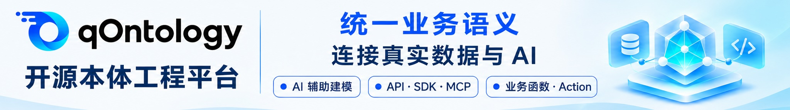
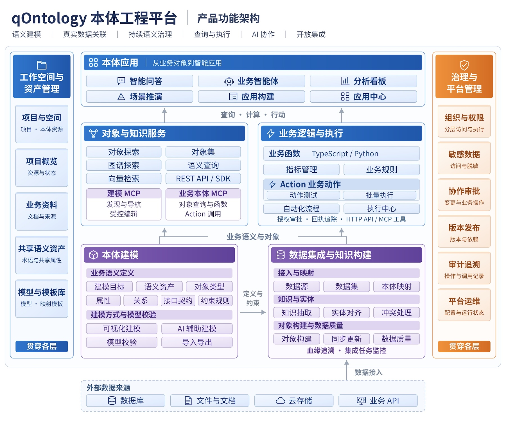
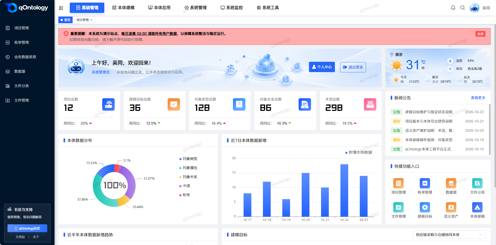
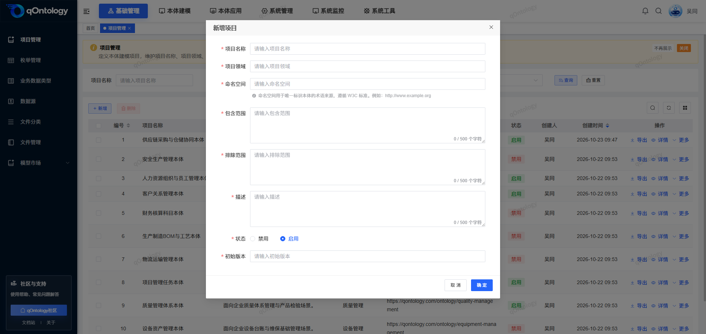
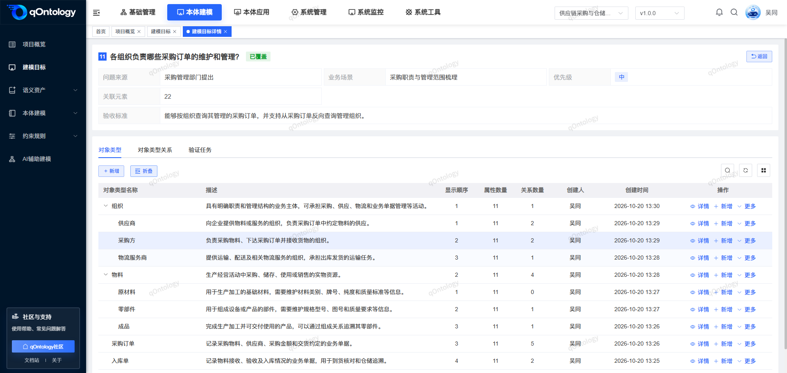
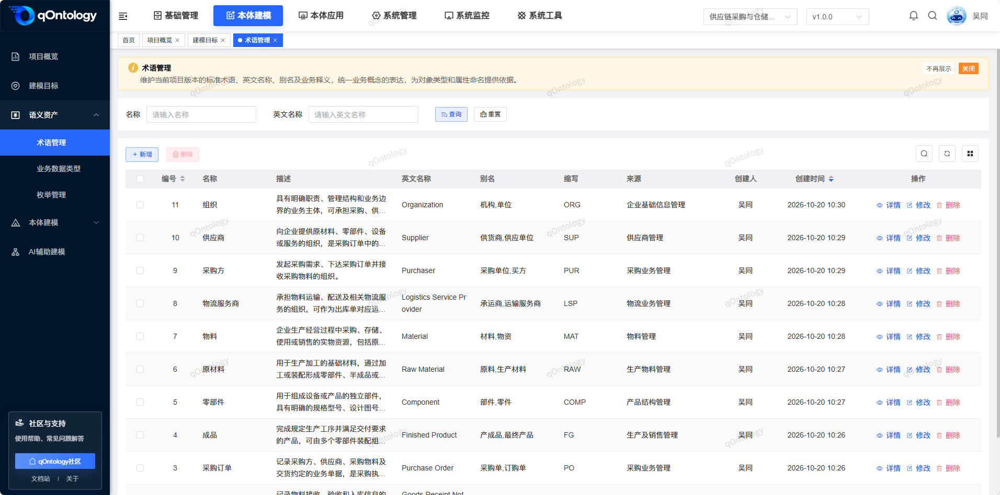
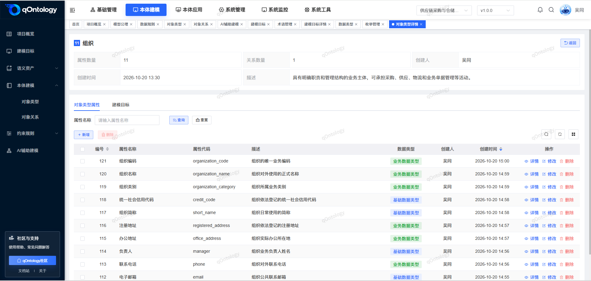
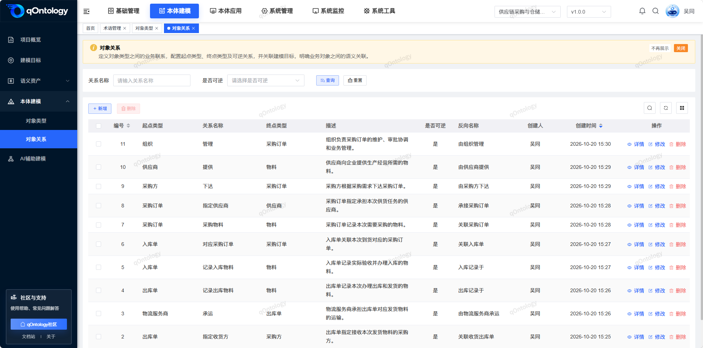
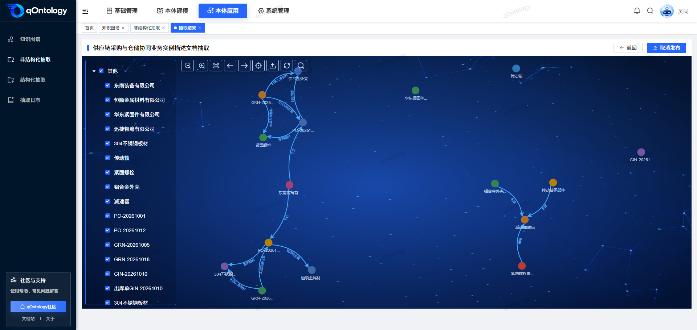
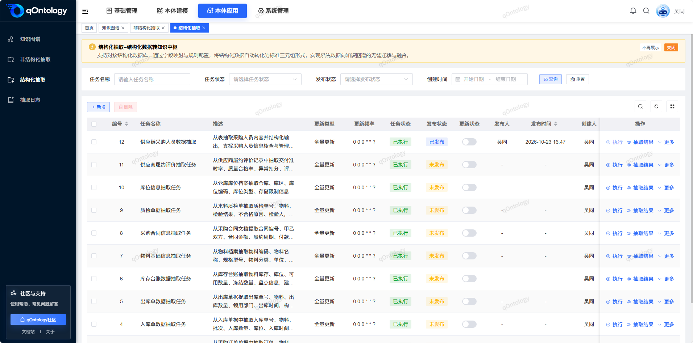

 
 
 
 
 
 
 

  📖简体中文 | <a href="README.en.md">📖English</a>

## 平台简介

**围绕业务对象统一语义、关联数据，为应用与 AI 提供可复用的业务能力。**

qOntology 是一款开源本体工程平台，聚焦 **业务语义治理与数据关联**。它将业务中的对象、属性、关系和规则，与数据库、API 和文档中的真实数据建立联系，为开发者提供从领域建模、对象构建到查询、计算和业务执行的完整能力。

你可以用 qOntology 建立项目的领域模型、组织跨来源的业务数据，开发本体驱动的问答、智能体和业务应用；也可以通过 API、SDK 或 MCP，把模型、数据和业务逻辑接入已有系统。多个应用能够复用同一套业务定义、对象关系与调用规则。

✨✨✨**在线文档**✨✨✨ <a href="https://docs.qontology.cn/" target="_blank">https://docs.qontology.cn/</a>

✨✨✨**演示地址**✨✨✨ <a href="https://demo.qontology.cn" target="_blank"> https://demo.qontology.cn </a> ，账号：`qOntology` 密码：`qOntology123`

> 如果 qOntology 对您有帮助，请点个 **Star ⭐️**，这是我们持续更新的最大动力！ 🚀

## 从一个业务对象开始

在 qOntology 中，**对象类型**定义一类业务事物的含义与结构，**对象实例**对应现实中的具体设备、订单或客户。数据映射与知识抽取将真实记录关联到对象，函数和 Action 则让对象具备可调用的业务能力。

以设备运维为例，你可以这样组织自己的业务：

| 围绕设备组织什么 | 如何表达或实现 |
| --- | --- |
| **业务定义** | 定义设备、工单和维修单位，描述设备编号、运行状态、所属单位及关联工单。 |
| **真实数据** | 将设备台账、工单表和检修文档中的信息关联到同一设备，保留属性与关系的来源。 |
| **查询与计算** | 查询存在未关闭工单的设备，通过自定义函数计算待处理工单数量或维修优先级。 |
| **业务动作** | 将已对接的工单 API 封装为 Action，按授权创建跟进任务，查看执行结果与外部回执。 |

这套对象模型和业务能力可以同时供业务页面、外部应用与智能体使用。

## 快速开始

### 在线体验

访问 [qOntology 演示环境](https://demo.qontology.cn)，无需安装即可了解产品。

**账号：`qOntology`　密码：`qOntology123`**

推荐先查看项目中的对象类型、属性与关系，再查看抽取结果和知识图谱，了解业务定义与实际数据之间的联系。

### 选择部署方式

- **[Docker Compose 部署](https://docs.qontology.cn/docs/deploy/docker-compose-deployment.html)**：按文档配置并启动本地环境，适合快速体验与部署。
- **[源码启动](https://docs.qontology.cn/docs/deploy/build-from-source.html)**：启动前后端开发环境，开展二次开发与功能扩展。
- **[自主部署](https://docs.qontology.cn/docs/deploy/manual-deployment/)**：自行安装与管理服务，适合已有基础设施及个性化部署需求。

环境要求、安装步骤、组件配置与常见问题，统一查阅[部署指南](https://docs.qontology.cn/docs/deploy/deploy-open-source.html)。

## 产品功能架构

## 系统配图

<table>
    <tr>
        <td></td>
        <td></td>
    </tr>
    <tr>
        <td></td>
        <td></td>
    </tr>
    <tr>
        <td></td>
        <td></td>
    </tr>
    <tr>
        <td></td>
        <td></td>
    </tr>
    <tr>
        <td></td>
        <td></td>
    </tr>
</table>

## 能力概览

| 能力模块 | 主要功能 |
| --- | --- |
| **工作空间与资产管理** | 组织项目与本体空间，管理项目概览和业务资料，维护共享术语、属性、类型、参考数据及模型与映射模板，支持跨项目引用和资产复用。 |
| **本体建模** | 围绕业务目标维护语义资产，定义对象类型、属性、关系、本体接口契约与约束，结合可视化画布和 AI 建议构建模型，支持结构验证、目标覆盖检查及导入导出。 |
| **数据集成与知识构建** | 连接数据源，管理数据集与本体映射，完成知识抽取、实体对齐、冲突处理和质量校验，构建业务对象，按连接能力刷新或同步，追踪来源血缘与任务状态。 |
| **对象与知识服务** | 提供对象搜索、详情、关系探索、对象集、图谱探索、向量相似性检索与语义查询，通过 REST API、SDK、建模 MCP 和业务本体 MCP 提供服务，管理调用范围、权限与记录。 |
| **业务逻辑与执行** | 使用 TypeScript、Python 函数组织计算，配置指标、规则和 Action，开展动作测试、批量执行、审批与自动化，通过执行中心查看参数、状态、结果和外部回执，处理运行异常。 |
| **本体应用** | 构建智能问答、业务智能体、分析看板与场景推演，组合列表、详情、表单和图表组件，绑定指标与授权 Action，支持应用管理、交互配置、预览、发布与访问控制。 |
| **治理与平台管理** | 管理组织、角色与资源权限，覆盖敏感数据控制、协作审批、版本发布、依赖检查、审计追溯、服务监控与运行配置，支撑模型、数据和业务能力的持续维护。 |

功能配置、使用流程和接口说明请查阅[文档中心](https://docs.qontology.cn/)。

## 定义业务语义

从业务问题出发，明确“有哪些对象、它们如何关联、需要满足哪些规则”，把这些定义沉淀为可复用的模型。

- **建立领域模型**：定义对象类型、继承关系、属性、对象关系与约束；通过本体接口契约约定多个对象类型共有的属性和语义。
- **统一业务含义**：维护术语、别名、共享属性、数据类型、枚举与参考数据，关联建模目标和对应的本体元素，检查模型对业务问题的覆盖情况。
- **可视化与 AI 辅助建模**：在画布中创建和组织对象与关系；依据文档、数据表字段或自然语言生成候选模型，经人工确认后纳入草稿，并进行结构与约束校验。
- **组织和复用模型资产**：按项目管理资料与语义资产，引用模型和映射模板，通过导入导出交换本体定义。

## 关联真实数据

让业务模型对应实际对象，需要明确对象身份、字段含义、关系来源，以及多个来源之间的取值规则。qOntology 将这些配置与对象构建过程连接起来。

- **连接数据并建立映射**：接入数据库、文件、云存储和业务 API，发现数据集，通过业务主键确定对象身份，将源字段、外键和中间表映射为对象属性与关系。
- **从文档补充业务信息**：依据本体抽取候选对象、属性和关系，查看原文依据，校验并确认结果后送入对象构建流程。
- **识别同一实体，处理不同取值**：根据业务标识和属性比较识别跨来源的同一对象，核对匹配依据，配置属性来源优先级，处理冲突并保留人工确认记录。
- **构建和更新对象**：根据映射与抽取结果生成对象实例，按连接能力配置定期刷新、增量更新或按需读取，查看对象更新时间及构建批次。
- **检查质量与追溯来源**：校验必填、唯一性、类型及关系完整性；从对象属性追溯源字段或文档片段，结合血缘定位映射和上游数据问题。

## 接入应用与 AI

应用可以围绕业务对象使用数据：通过对象服务读取信息，通过函数与规则计算和判断，通过 Action 执行业务修改或外部调用。

### 查询对象，复用业务计算

通过对象搜索、详情和关系遍历获取业务信息，将查询结果或筛选条件保存为对象集，供后续分析和批量操作复用。支持图谱探索、语义查询与向量相似性检索，帮助用户发现关联对象和来源资料。

使用 **TypeScript、Python 业务函数**读取对象属性、遍历关系和组合计算，声明输入、输出与依赖；结合指标与规则，把计算口径和判断逻辑提供给看板、业务页面与智能体。

### 通过 Action 执行业务操作

将业务函数、HTTP API 或 MCP 工具绑定到 **Action（业务动作）**，配置参数、前置条件与执行授权，按需要增加确认或审批。动作可以修改对象与关系，也可以调用已对接的外部业务系统。

支持动作测试、批量执行与自动化流程，在执行中心查看输入参数、执行状态、结果和回执，定位失败原因并处理异常。查询、计算与执行各有明确入口，业务操作可以持续追踪。

### 选择应用和 AI 的接入方式

| 接入方式 | 使用范围 |
| --- | --- |
| **REST API / SDK** | 在已有应用中查询对象、遍历关系和调用预定义 Action；通过 REST API 调用业务函数，复用本体中的数据与逻辑。 |
| **建模 MCP** | 向 AI 开发工具提供本体发现、语义导航与受控编辑能力，辅助理解和维护模型定义。 |
| **业务本体 MCP** | 向智能体提供真实对象查询、函数和预定义 Action，在授权范围内使用业务数据与执行能力。 |

也可以直接在平台内构建本体应用：组织智能问答、智能体、分析看板与场景推演，组合对象列表、详情、表单和图表，绑定指标及 Action，发布面向具体业务的交互页面。

服务配置、调用方式和功能使用说明见[文档中心](https://docs.qontology.cn/)。

## 持续治理模型、数据与执行

模型、数据映射和应用会不断变化。qOntology 将语义资产的维护、发布和使用联系起来，支持团队持续管理这些依赖。

- **版本与变更影响**：管理模型、映射、函数和 Action 的版本，对比修改内容，检查依赖与兼容性，定位可能受影响的服务和应用。
- **审核与发布**：结合质量检查、发布审批和历史记录管理变更，让共享业务定义和调用契约有据可查。
- **分层授权**：按项目和角色管理协作，分别控制模型编辑、对象及敏感字段访问、业务动作执行权限。
- **运行与审计**：查看集成任务、对象构建和动作执行记录，追踪服务调用与人工修改，结合日志、状态和运行指标排查问题。

## 开发与扩展

qOntology 采用前后端分离架构。开发者可以从领域模型与数据映射开始，逐步增加业务函数、动作和接口集成，也可以定制前后端代码。

| 层次 | 主要技术 |
| --- | --- |
| 后端 | JDK 17、Spring Boot 3、Spring Security、MyBatis 相关组件 |
| 前端 | Vue 3、Vite、Element Plus、Pinia、ECharts |
| 数据存储与基础服务 | MySQL、Redis、Neo4j，按启用能力与部署配置准备 |

## QQ交流群

欢迎加入 qOntology 官方 QQ 交流群，交流本体建模、数据关联、接口集成与应用实践，反馈使用问题并了解项目动态。

👉 **<a href="https://docs.qontology.cn/discuss.html">点击加入 QQ 交流群</a>**

## 许可与商业服务

qOntology 由[江苏千桐科技有限公司](https://qiantong.tech/)维护，按 **Apache License 2.0 及项目附加条件**提供，支持商业使用。使用时需遵守 [LICENSE](LICENSE)，保留其中要求的 Logo、版权、许可与署名信息。

如需去除或修改相关标识、白标、OEM 或重新包装为其他产品，请取得相应商业授权。品牌定制授权、专业版与技术服务咨询，请查看[商业合作说明](https://docs.qontology.cn/business/policy.html)。